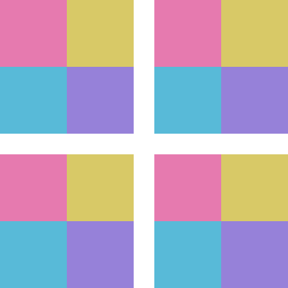

<div align="center">
  
  <h1>Tilecheck</h1>
  <p><strong>Pattern Preview Tool</strong></p>
  <p>Preview patterns, test repetitions, and spot visible seams.</p>
  <p>
    <a href="https://tilecheck.pages.dev/"><strong>Open app</strong></a> ·
    <a href="docs/USAGE.md">User guide</a> ·
    <a href="https://tilecheck.pages.dev/help.html">Help & FAQ</a> ·
    <a href="https://github.com/Treenixie/Tilecheck/issues">Issues</a>
  </p>
</div>

---

## About

Tilecheck is a small, browser-based tool for checking how textures behave when repeated. It helps artists and game developers preview tiled patterns, compare mirrored repeats, and identify potential seams before using an image in a project.

Everything runs in the browser. There is no account, server-side image processing, or build step.

## How it works

1. **Add an image.** Drop a texture onto the preview, choose a file, or paste an image from the clipboard.
2. **Choose an inspection mode.** Switch between tiled repetition, mirrored repetition, and the seam map.
3. **Adjust the preview.** Change the repeat grid or zoom, and optionally show tile boundaries.
4. **Export the result.** Save the current preview as a PNG.

The original image stays visible in the sidebar. Inspection controls remain disabled until an image is loaded.

## Inspection modes

| Mode | What it shows |
| --- | --- |
| **Tile** | Repeats the texture in an adjustable 2 × 2 to 6 × 6 grid. |
| **Mirror** | Alternates reflected tiles to compare a mirrored repeat with a regular one. |
| **Seam map** | Highlights differences between opposite image edges that may produce visible seams. |

Supported inputs: **PNG, JPEG, WebP, and AVIF** (subject to browser support). Files are limited to **25 MB** and **24 megapixels**.

## Get started

**Use it online:** [Launch Tilecheck](https://tilecheck.pages.dev/). No installation is needed.

**Run it locally:**

```sh
git clone https://github.com/Treenixie/Tilecheck.git
cd Tilecheck
python -m http.server 8080
```

Open [http://localhost:8080](http://localhost:8080) in your browser. The application is a static HTML/CSS/JavaScript site, with no dependencies to install or build process. You can also open `index.html` directly in a compatible browser.

## Project structure

| Path | Purpose |
| --- | --- |
| [`index.html`](index.html) | Main texture inspector |
| [`help.html`](help.html) | In-app help and FAQ |
| [`assets/main.js`](assets/main.js) | Image loading, inspection, and PNG export |
| [`assets/styles.css`](assets/styles.css) | Layout and visual styles |
| [`assets/`](assets/) | Logo, icons, and checkerboard artwork |
| [`docs/USAGE.md`](docs/USAGE.md) | User guide |
| [`CONTRIBUTING.md`](CONTRIBUTING.md) | Contribution and testing notes |

## Limitations

The seam map is a **visual aid**, not a guarantee that a texture is seamless. Its edge comparison is based on RGB differences; it does not validate UV layouts, normal maps, or other PBR textures. Tilecheck previews images but does not repair seams.

## Privacy

Imported images are decoded, analyzed, and exported **locally in your browser**. Tilecheck does not upload textures and includes no analytics scripts. When online, the site may request Roboto from Google Fonts. Hosting and outbound links have their own privacy policies.

## Contributing

Bug reports, suggestions, and focused pull requests are welcome. See [Contributing](CONTRIBUTING.md) for the development workflow. For bugs, include your browser, image format and dimensions, inspection mode, and steps to reproduce. Do not attach confidential textures to public issues.

## License

[MIT License](LICENSE) · Made by [Treenixie](https://github.com/Treenixie).
