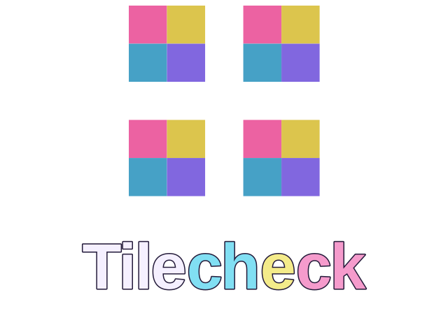

  

  
  
  
  

**Tilecheck** is a lightweight browser tool for inspecting repeating textures. Preview patterns, compare mirrored repeats, and spot visible seams without uploading images.

[**Open Tilecheck**](https://tilecheck.pages.dev/) · [User guide](docs/USAGE.md) · [Help & FAQ](https://tilecheck.pages.dev/help.html) · [Report a bug](https://github.com/Treenixie/Tilecheck/issues/new/choose)

## Features

- Import textures by drag and drop, file picker, or clipboard paste.
- Preview regular and mirrored repetitions or inspect possible seams.
- Adjust the grid from **2 × 2 to 6 × 6** and preview zoom from **50% to 200%**.
- Toggle tile boundaries and compare against the unchanged original.
- Export the selected repeating pattern as a PNG.
- Process textures locally in the browser. No account or build step required.

## Inspection modes

- **Tile:** Regular repeating pattern in an adjustable grid.
- **Mirror:** Alternating horizontal and vertical reflections.
- **Seam map:** Highlights differences between opposite image edges. It is a visual aid, not a guarantee of seamlessness.

Supported files: **PNG, JPEG, WebP and AVIF** (depending on browser support), up to **25 MB** and **24 megapixels**. Controls are disabled until an image is loaded; Reset clears it and restores the default settings.

## Get started

Use the [online application](https://tilecheck.pages.dev/) or run it locally:

~~~sh
git clone https://github.com/Treenixie/Tilecheck.git
cd Tilecheck
python -m http.server 8080
~~~

Open [http://localhost:8080](http://localhost:8080). Tilecheck uses plain HTML, CSS and JavaScript, with no installation or build dependencies. Opening `index.html` directly also works in compatible browsers.

## Project files

- [`index.html`](index.html) and [`help.html`](help.html): application and help pages.
- [`assets/main.js`](assets/main.js) and [`assets/styles.css`](assets/styles.css): inspection logic and interface.
- [`assets/`](assets/): logos, icons, checkerboard and supporting scripts.
- [`docs/USAGE.md`](docs/USAGE.md): detailed usage and export notes.

## Notes

Export saves the tiled or mirrored pattern as a PNG. Preview zoom, guides and the checkerboard background are not included. Output is limited to **8192 pixels per side** and **24 megapixels**; larger repeats are scaled down. Tilecheck does not modify source images or repair seams.

Images are processed locally, without server-side image uploads or analytics. The hosted site may load Roboto from Google Fonts; the host and external links have their own privacy policies.
